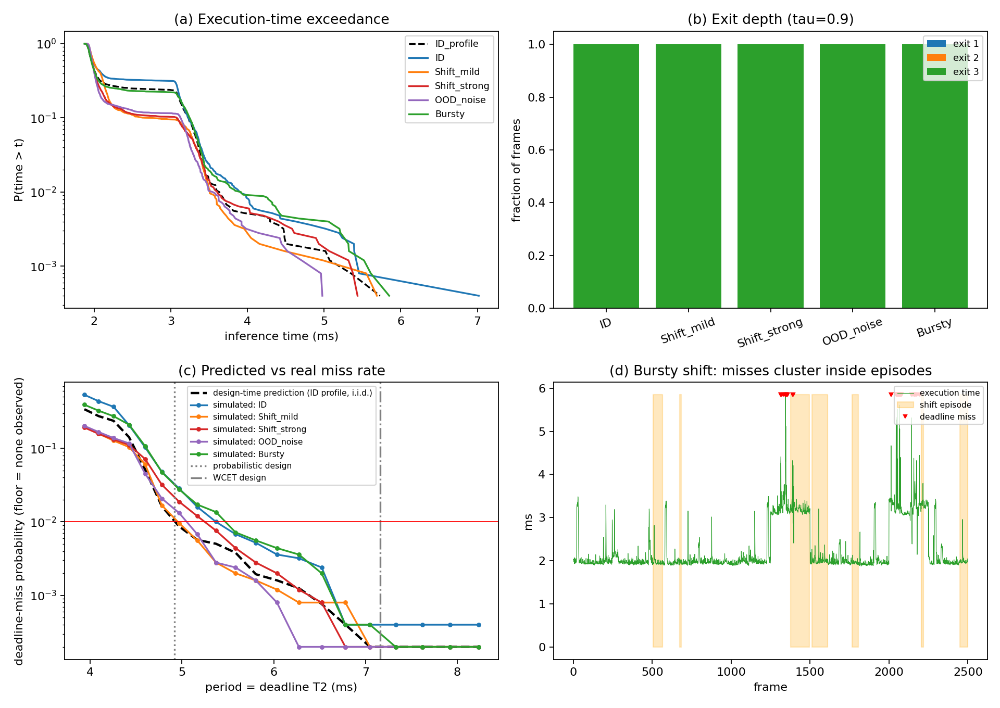

# Inference-timing pilot: does convolution-based probabilistic response-time analysis hold for neural-network inference?

Pilot for the MSc research proposal *Testing the Independence Assumption of Convolution-Based Probabilistic Response-Time Analysis on Embedded Neural-Network Inference* (Ashhar Hussain).

Convolution-based probabilistic response-time analysis combines execution-time distributions as if they were independent. This pilot checks that assumption on measured neural-network inference times.

## What the notebook does

- Times 20,000 single-thread CPU inferences of a small 3-exit CNN (scikit-learn digits, upsampled to 32×32) across 8 conditions, interleaved in random order: in-distribution (profiling and fresh session), Gaussian-noise shift (σ = 0.25 and 0.5), OOD uniform noise, bursty shift episodes, and a full-depth "static" control.
- Implements a simplified convolution-based stochastic response-time analysis (stationary hyperperiod backlog + split–convolve–merge) for a two-task fixed-priority preemptive set on one core: a control task 4× per frame (execution U[0.8, 1.2] × 0.298 ms) above the inference task (period = deadline).
- Designs the shortest period whose predicted miss rate is ≤ 1% from the in-distribution profile, then compares the prediction with trace-driven simulation of the measured execution times, in real order and shuffled.

This is a simplified uniprocessor analysis, not a reproduction of the CAN analysis in Yi et al., IEEE TII 2026 (https://doi.org/10.1109/TII.2025.3609226).

## Results (one run; Google Colab, Intel Xeon @ 2.20 GHz, 2 vCPUs, PyTorch 2.14.1+cpu)

Design period from the in-distribution profile: **4.921 ms** (predicted miss 1.00%), 31% shorter than a design based on the maximum observed execution time (**7.160 ms**).

| Condition | Analysis (independence, own distribution) | Simulation, shuffled | Simulation, real order [95% block-bootstrap CI] | Real / shuffled |
|---|---|---|---|---|
| In-distribution, fresh session | 1.94% | 1.72% | 3.20% [1.16, 6.28] | 1.9× |
| Mild noise shift (σ = 0.25) | 0.66% | 0.64% | 0.96% [0.00, 2.60] | 1.5× |
| Strong noise shift (σ = 0.5) | 0.95% | 0.84% | 2.08% [0.04, 5.24] | 2.5× |
| OOD (uniform noise) | 0.73% | 0.60% | 1.40% [0.24, 3.12] | 2.3× |
| Bursty shift episodes | 1.72% | 1.56% | 3.12% [0.48, 6.88] | 2.0× |

- **The analysis is consistent with its own assumption:** it matches the shuffled (independent) simulation within 0.22 percentage points.
- **Execution times are not independent:** lag-1 autocorrelation is 0.88–0.93 in every condition, and in real order the miss rate exceeds the shuffled simulation in all five conditions (1.5–2.5×).
- **Session drift:** with the same input distribution, a fresh session's analysis already predicts 1.94% instead of 1%, and its real order gives 3.20%. Even the maximum observed execution time is exceeded (7.02 ms vs 5.73 ms profiled).
- **Input does not drive full-depth latency:** under strong shift the median changes by +0.2% (static control) while accuracy falls from 0.80 to 0.53.

## What did not work

The early-exit heads never reached the 0.90 confidence threshold (the model reached 80% clean accuracy after 8 epochs), so every frame ran at full depth. The early-exit / distribution-shift question is therefore **untested** here. Evaluating the unused exits cost 13–15% median latency compared with the static network.

## Limitations

Shared cloud CPU (likely exaggerates temporal dependence compared with a dedicated embedded board), toy model and dataset, simplified uniprocessor analysis, a single run, and wide confidence intervals: only the fresh in-distribution interval excludes the 1% design value.

## Files

- `timing_reliability_pilot.ipynb` — the notebook, with outputs (Colab → Runtime → Run all, about 3 minutes on a CPU runtime)
- `results/summary.json`, `results/miss_table.csv`, `results/timing_stats.csv` — all numbers
- `results/timings.npz` — every raw execution time and exit depth, in measurement order
- `results/pilot_figure.png` — figure; `results/early_exit_cnn.pt` — trained weights
